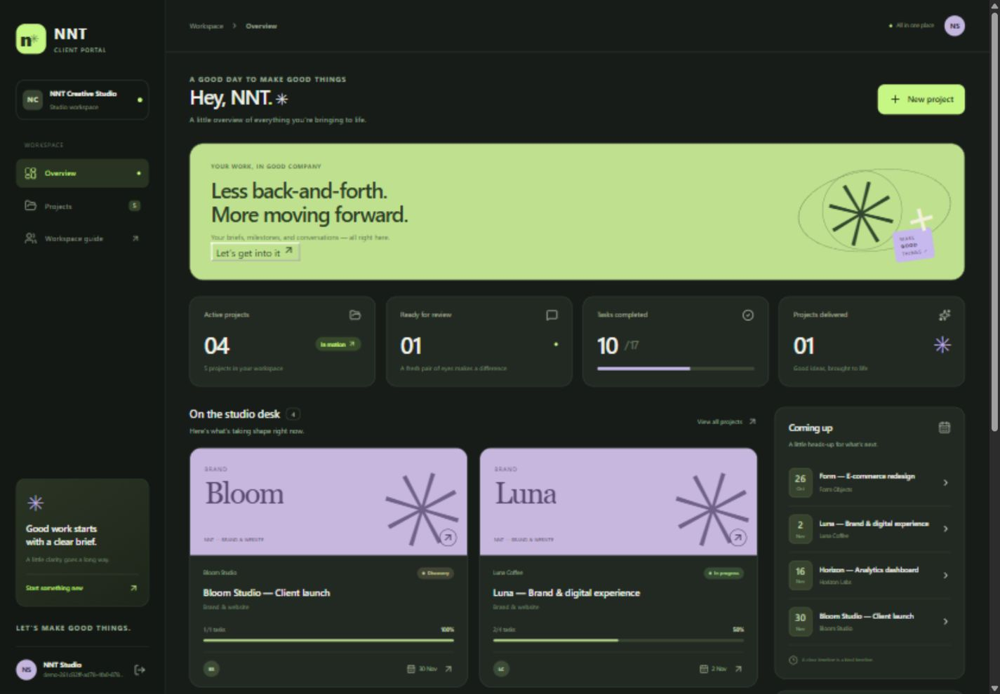

# NNT Client Portal

A freelance studio workspace for turning a client brief into visible progress, shared files, feedback, and delivery approvals.

[](https://github.com/nnt2525/nnt-client-portal/actions/workflows/verify.yml)

[Architecture](docs/ARCHITECTURE.md) · [Thai portfolio guide](docs/PORTFOLIO_TH.md) · [Local walkthrough](docs/WALKTHROUGH.md)



The GitHub source is public and the full application runs locally. Online hosting is pending explicit approval for a separate hosting destination. A private Sites target has been prepared but has not been published. An application invitation cannot bypass a host's access policy.

Built as one complete portfolio project: a responsive React interface, a TypeScript API, database migrations, session authentication, project permissions, and private file storage. The visual direction uses charcoal, warm ivory, lime, and lavender.

## The workflow

1. A studio owner creates a workspace and a project brief with scope, budget, and a deadline.
2. The owner adds tasks and milestones, then copies a one-use client invitation link.
3. The client signs in and joins that specific project.
4. Both sides upload project files and leave feedback. The owner moves work forward; the client approves a milestone after it is marked ready.
5. The dashboard derives progress and deadlines from saved records.

This version does not process payments, send invitations by email, or generate AI responses. A project budget is a recorded estimate in THB, not an invoice or payment transaction.

## Try it locally / เริ่มใช้งานในเครื่อง

Use Node.js 22.13 or newer and npm. Run these commands from the repository folder:

```sh
npm ci
node scripts/setup-local.mjs
npm run build
npm run db:migrate
npm run dev
```

The setup helper writes a randomly generated local auth secret to the ignored `.dev.vars` file. Open the local URL printed by the development server (port 5173 by default). The first build creates the Worker configuration used by the local database migration. Local D1 and R2 data are stored in the ignored `.wrangler/state/` directory.

ภาษาไทย: ติดตั้ง dependencies → สร้างค่าตั้งต้นสำหรับเครื่อง → build → สร้างตารางฐานข้อมูล → เปิดเว็บ จากนั้นสมัครบัญชีเจ้าของและสร้าง workspace ของตัวเอง หรือใช้ปุ่มทดลองเดโมซึ่งสร้างข้อมูลตัวอย่างแยกให้แต่ละครั้ง ไม่ต้องใช้รหัสผ่านร่วมกับคนอื่น

The isolated demo is for disposable sample work. Use a regular account for work you need to return to. Keep real client information out of a public demonstration environment.

## What each role can do

| Action | Workspace owner | Invited client |
| --- | --- | --- |
| View a project | Any project in their workspace | Joined projects only |
| Create projects and edit briefs | Yes | No |
| Create/update tasks | Yes | No |
| Create milestones or mark them ready | Yes | No |
| Approve a ready milestone | No | Yes |
| Upload/download project files | Yes | Yes, for joined projects |
| Delete a project file | Yes | No |
| Add feedback | Yes | Yes, for joined projects |
| Create invitation links | Yes | No |

The API checks these permissions on the server for each request. Hiding a button is not the access-control mechanism. An invitation grants membership of one project, never ownership of the workspace.

## Stack and structure

| Layer | Implementation |
| --- | --- |
| Interface | React, TypeScript, custom responsive CSS |
| Web runtime | Vinext with the Next.js App Router API |
| API | Server route handlers, Zod validation |
| Authentication | Better Auth email/password sessions |
| Data | Cloudflare D1 and Drizzle ORM |
| Files | Private Cloudflare R2 bucket, downloaded through an authorized API route |

```text
app/                    Page, layout, and API routes
components/portal/      Portal screens and interaction components
lib/contracts.ts        Shared frontend/backend response types
lib/server/             Authentication, permissions, validation, and portal services
db/                     Drizzle schema and database access
drizzle/                Versioned SQL migrations
scripts/                Local setup and build helpers
docs/                   Architecture, API, walkthrough, and portfolio notes
```

## Data and account boundaries

- Every project belongs to a workspace. A client receives access through explicit project membership.
- Session identity comes from Better Auth on the server; a request cannot select its own user ID or role.
- Invitation tokens expire after seven days and can be redeemed once. Only their hashes are stored. Anyone with the secret link can redeem it while signed in; the brief's contact email is display information, not proof of identity.
- Files remain in private storage. The download route checks project access and sends an attachment response without exposing storage keys.
- Uploads are limited to 8 MiB per file, 20 files per project, and 40 MiB total per project. Supported formats include PDF, PNG, JPEG, WebP, and UTF-8 plain text. Executable files, HTML, and SVG are rejected.
- The database stores budget values as integer satang to avoid floating-point currency arithmetic.

Email ownership is not verified in this MVP, and a password-reset mailer is not configured. Do not treat the demo as a production client service without addressing account recovery, operational controls, and your intended hosting policy.

## Development

```sh
npm run dev          # Development server
npm run lint         # Lint source
npm run typecheck    # TypeScript checks
npm run build        # Build the application and Worker artifact
npm start            # Preview the built Worker locally
npm run db:generate  # Generate migrations after a schema change
npm run db:migrate   # Apply pending local migrations
npm run test:integration # API integration checks against a running server
```

Database migrations are schema changes; sample project data are created only when the demo workflow is explicitly requested. Keep local secrets, `.wrangler/`, `.sites-runtime/`, dependencies, and build output out of Git.

Integration checks use `http://127.0.0.1:5173` by default; set `BASE_URL` to test another local server. They exercise the backend rather than replacing browser checks of the interface.

## Project notes

- [Architecture and access rules](docs/ARCHITECTURE.md)
- [API reference](docs/API.md)
- [Owner and client walkthrough](docs/WALKTHROUGH.md)
- [Local and hosted deployment boundaries](docs/DEPLOYMENT.md)
- [Local verification results and remaining checks](docs/VERIFICATION.md)
- [สิ่งที่เรียนรู้และแนวทางอธิบายตอนสัมภาษณ์](docs/PORTFOLIO_TH.md)

The documentation describes the bounded MVP. Public source hosting and application hosting are separate: GitHub Pages cannot run this database-backed Worker application.
