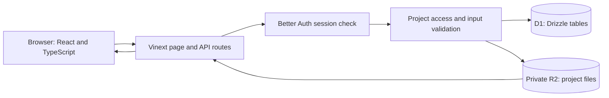
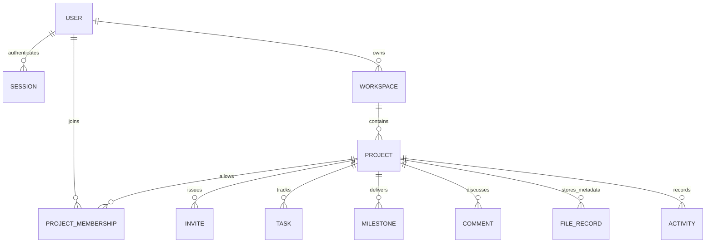

# Architecture

NNT Client Portal has one application boundary: a browser calls the same-origin API, which authenticates the request, checks access, and reads or writes D1 and R2. The browser never receives a database credential or an R2 object key.

## Responsibilities

| Part | Responsibility |
| --- | --- |
| React components | Form state, navigation, loading/error/empty states, responsive presentation |
| Shared contracts | Typed request/response shapes across the frontend and backend |
| Better Auth | Password-based account authentication and session cookies |
| Portal server services | Workspace/project permissions, allowed status transitions, validation, storage coordination |
| Drizzle and D1 | Relational records and parameterized queries |
| R2 | Private binary file content |
| SQL migrations | Reproducible schema changes, applied separately from requests |

Vinext supplies the App Router-compatible web runtime. Cloudflare bindings provide `DB` and `BUCKET`. In local development, the runtime simulates these bindings and persists their state under `.wrangler/state/`.

## Data relationships

This diagram shows logical relationships, not an exact SQL schema export. See `db/schema.ts` and `drizzle/` for actual table definitions.

A workspace has one owner. A client's membership is scoped to a project, so joining project A does not grant access to project B in the same workspace. Access checks begin with the authenticated user and the requested record's project; IDs supplied by the browser do not establish authority.

## Request flow

For a client uploading a design reference:

1. The browser submits a same-origin multipart request with its session cookie.
2. The server checks the session and the client's membership of the requested project.
3. The server checks file size, accepted type, relevant file signatures, and project storage limits.
4. R2 stores the bytes privately; D1 stores metadata and an activity record.
5. The response returns safe metadata. A later download repeats the access check and returns an attachment through `/api/portal/files/:id`.

For milestone approval, the client must belong to the project and the milestone must already be `ready`. The owner can prepare work for review, but cannot approve it on behalf of the client. Approval is recorded in activity.

## Invitation semantics

The owner creates an unguessable invitation. The database stores a hash, an expiry, and redemption state. The UI displays a copyable join URL; it sends no email. A signed-in user redeems the token once, and the server consumes it while creating project membership.

The secret invitation link is the authorization to join. The project's client email does not restrict redemption or verify identity. Send the link privately to the intended recipient.

## Representation and validation

- Timestamps use ISO strings; due dates use `YYYY-MM-DD`.
- `budgetCents` means integer satang in THB. For example, `125050` represents ฿1,250.50.
- Project statuses: `discovery`, `in_progress`, `review`, `completed`.
- Task statuses: `todo`, `in_progress`, `done`.
- Milestone statuses: `pending`, `ready`, `approved`.
- Error responses use `{ "error": "message" }` and a non-success HTTP status.
- Mutations require same-origin requests. The server validates inputs, dates, roles, and record relationships before accepting a change.
- Private API responses and file downloads should not be reused as shared public cache content.

## Deployment boundary and limitations

The source repository is portable application source; the app requires a compatible Worker runtime, D1 binding, R2 binding, auth configuration, and applied migrations. Publishing source on GitHub does not deploy the backend. GitHub Pages serves static files and cannot run this application by itself.

The MVP includes no payment provider, outgoing invitation email, AI service, email verification, or password-reset mailer. It has no billing, legally binding e-signature, or production uptime claim. Milestone approval is an application workflow event.

Back up D1 and R2 together when operating a real instance: the database stores file metadata while the bucket stores the bytes. Local `.wrangler/state/` is development state, not a backup strategy. Browser sessions, local secrets, private client data, and uploaded files must not be committed to the public source repository.
